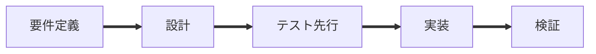

<!--
タイトルはコミットの1行目と同じ形にし、決定の記録があれば後ろに番号を付ける（例：feat(pipe-in): …（Dnnnn））。
決まりは docs/development/workflow.md の「7. PR と issue」。
秘密（API キー・トークン・.env・鍵）と、ユーザー名の入った絶対パス・社内や私的なプロジェクトの名前・メールアドレスは書かない。ログやパスは消してから貼る。
-->

## 何を変えたか

<!-- 何ができるようになるか。変えた点を箇条書きで -->

## なぜ（決定の記録・関わる issue）

- 決定の記録：Dnnnn（docs/decisions/Dnnnn-<名前>.md）
- 関わる issue：#番号（この PR で閉じるなら「Closes #番号」）

## 受け入れ基準と確かめたテスト

| AC | 確かめたテスト | 結果 |
| --- | --- | --- |
| Dnnnn-AC-01 | tests/test_xxx.py の test_… | 合格 |

## 確かめたこと（テスト・手で・実機）

- [ ] pytest -q（文書だけの変更でも流す）
- [ ] npm test・npm run typecheck・npm run build（拡張に触れたとき）
- 手で：（無ければ「なし」）
- 実機：（確かめていなければ「まだ」）

## 図（任意）

図は任意。変更の流れ・依存の向きや層・段や状態の移り変わりを示すときに使う。使うときは、下の見本を囲むコメントの始まりと終わりの印の行を消す。コメントの中では矢印を ==> で書く（細い矢印の書き方は、コメントの終わりの印と同じ文字になるため）。

<!--

-->

## 公開してよいかの確認

- [ ] 秘密（API キー・トークン・.env・鍵）を書いていない
- [ ] 手元の事情（ユーザー名の入った絶対パス・社内や私的なプロジェクトの名前・メールアドレス）を書いていない。ログやパスは消してから貼った
- [ ] docs/pipeline/ の記録を載せていない
