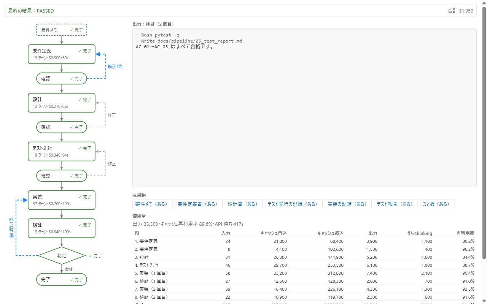
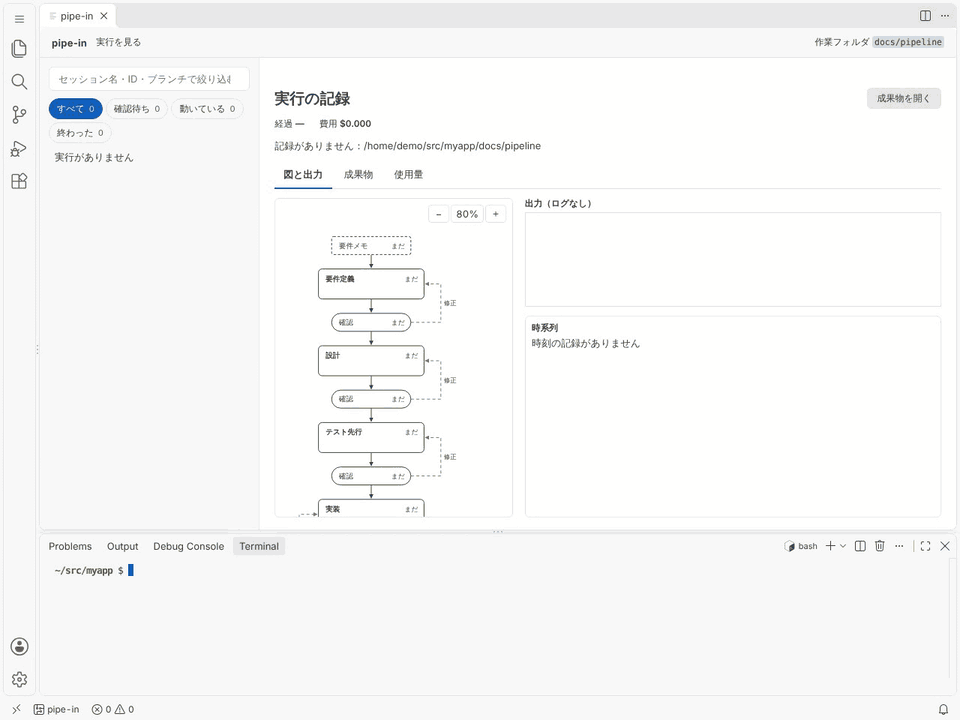
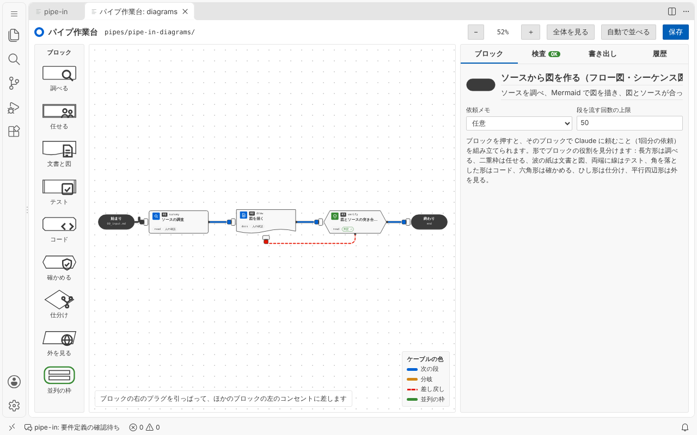

<h1>
  <picture>
    <source media="(prefers-reduced-motion: reduce) and (prefers-color-scheme: dark)" srcset="docs/assets/pipe-in-logo-dark.svg">
    <source media="(prefers-reduced-motion: reduce)" srcset="docs/assets/pipe-in-logo.svg">
    <source media="(prefers-color-scheme: dark)" srcset="docs/assets/pipe-in-plug-logo-dark.gif">
    
  </picture>
</h1>

pipe-in runs **requirements → design → tests first → implementation → verification** in order from a requirements memo, using the Claude Agent SDK (Python), and a person checks the result at each stage boundary before it goes on.

This is the English entry page. The detailed guides under `docs/guide/` are written in Japanese only.

<picture>
  <source media="(prefers-color-scheme: dark)" srcset="docs/assets/run-panel-dark.png">
  
</picture>

<sub>The panel of the VSCode extension. A sample record (the numbers are samples) shown on the extension's real screen.</sub>

- It stops at each stage boundary, and a person chooses approve / request changes / abort. → [Usage](docs/guide/usage.md) (Japanese)
- It has the tests written first and checks that they fail, and if verification fails it sends the work back to implementation (up to 3 times by default). → [How the development flow runs](docs/guide/usage.md#開発フローの流れ) (Japanese)
- It sets what each stage may write, and blocks writes outside that range and dangerous operations. → [How safety works](docs/guide/safety.md) (Japanese)
- You can watch progress and usage as a diagram in a VSCode panel, and build pipes on a workbench. → [The VSCode extension](docs/guide/vscode.md) (Japanese)
- You can build and run your own "pipes" with a stage order you choose (drawing diagrams, checking a spec against the source, and so on). → [Pipes](docs/guide/pipes.md) (Japanese)
- It records cost, tokens, and usage limits per stage. → [Records and usage](docs/guide/records.md) (Japanese)

**Contents**: [Quick start](#quick-start) · [Documents](#documents) · [Migrating from the previous name](#migrate) · [License](#license) · [日本語](README.md)

## Quick start

### Requirements

- Python 3.11 or later
- Logged in to Claude Code (log in once with `claude`), or `ANTHROPIC_API_KEY` set
- The target project should be under git, and it is best to use a working branch

### Install

```bash
# Copy the repository to your machine
git clone https://github.com/nigoh/pipe-in.git
cd pipe-in

# Create a virtual environment
python -m venv .venv
# Activate it (either one)
. .venv/Scripts/activate        # Git Bash on Windows
source .venv/bin/activate       # macOS / Linux

# Install
pip install -e .                # installs pipe-in and pipe-in-gen
```

If you installed under the previous name, follow [Moving from the previous name](docs/guide/migrate.md) (Japanese) to reinstall.

### First run

```bash
# In the target project, run the development flow from a requirements memo
pipe-in --project ~/src/myapp --text "Add a CSV export button to the user list"
```

It stops after requirements and shows the top of the document to ask for your confirmation ([the confirmation screen](docs/guide/usage.md#確認の画面), Japanese). The records stay in the target's `docs/pipeline/` ([files that are created](docs/guide/records.md#作られるファイル), Japanese).

> [!IMPORTANT]
> It calls the Claude Agent SDK at every stage, so it costs money. Put the target under git and run it on a working branch.

### Watching in VSCode

Open the target project in VSCode with the extension installed, and choose "pipe-in: 実行を見る" (view runs) from the command palette to watch a running run in the panel. The status bar at the bottom also shows its current state. For how to install it, see [The VSCode extension](docs/guide/vscode.md) (Japanese).

If you run it from a Claude Code conversation with `/pipe-in --artifact <requirements memo>`, you can also watch progress (which stage is running, whether it is waiting for confirmation, elapsed time) in a Claude artifact next to the conversation. The buttons on a waiting row let you answer approve, send back, or abort from the page (a newly published page; only the artifact's editors can send). To watch a run going in a terminal, call `/pipe-in:pipe-live` (a plugin; `pipe-in live watch` runs behind it) in another conversation. → [Usage](docs/guide/usage.md#進み具合を-claude-のアーティファクトで見るpipe-in-live) (Japanese)

<picture>
  <source media="(prefers-reduced-motion: reduce) and (prefers-color-scheme: dark)" srcset="docs/assets/vscode-run-dark.png">
  <source media="(prefers-reduced-motion: reduce)" srcset="docs/assets/vscode-run-light.png">
  <source media="(prefers-color-scheme: dark)" srcset="docs/assets/vscode-usage-dark.gif">
  
</picture>

<sub>Usage video (about 40 seconds): the run panel is left open, the development flow runs in the terminal, and the confirmation screens are answered along the way. It runs with a fake that returns sample replies in place of the SDK (the numbers are samples).</sub>

"pipe-in: パイプ作業台を開く" (open the pipe workbench) opens the workbench where you build pipes. A saved pipe can be run from the "流す" (Run) section of the workbench.

<picture>
  <source media="(prefers-color-scheme: dark)" srcset="docs/assets/vscode-editor-dark.png">
  
</picture>

<sub>The pipe workbench in VSCode, with the template pipe diagrams open.</sub>

## Documents

The detailed guides are in `docs/guide/` (index: [docs/guide/README.md](docs/guide/README.md)). They are written in Japanese.

| Document | Contents |
| --- | --- |
| [Usage](docs/guide/usage.md) | The flow of the development flow, running, resuming, the confirmation screen, `--pause` and `--review`, `pipe-in record`, watching in a Claude artifact, answering with buttons, notes |
| [The VSCode extension](docs/guide/vscode.md) | Installing, viewing runs, the pipe workbench, running from the workbench |
| [For people who do not type commands](docs/guide/start-without-commands.md) | The way to view, choose a sample, and answer confirmations with only the extension, a browser, and a conversation, and where one line in a terminal is still needed |
| [Pipes](docs/guide/pipes.md) | How to build, check warnings, templates, sample pipes, `pipe.toml`, verification and send-back, branching, Agent SDK settings |
| [The Claude Code plugin](docs/guide/plugin.md) | Install with one line in a conversation, `/plugin install pipe-in --marketplace nigoh/pipe-in` (then install `pipe-in-gen` too), and what comes with it (`/pipe-in:pipe-build`, the pipe-builder, check, judge, and live skills, hooks, and `/pipe-in:pipe-run`, which runs a pipe inside the conversation where the SDK cannot start (not yet checked on a real machine)) |
| [How safety works](docs/guide/safety.md) | What each stage may write, and the operations blocked at every stage |
| [Records and usage](docs/guide/records.md) | The files that are created, the copy shown in the artifact, usage in the summary, exit codes |
| [Settings](docs/guide/config.md) | `pipeline.toml` |
| [Moving from the previous name](docs/guide/migrate.md) | Reinstalling, old commands, plugin, extension, locations, environment variables |
| [Developing pipe-in](docs/guide/develop.md) | When you want to change the internals, and developing with Claude Code |

The extension's detailed operation is in [vscode/README.md](vscode/README.md), the development rules are in [docs/development/](docs/development/), and what was decided for each feature is in [docs/decisions/](docs/decisions/). All of these are in Japanese.

<a id="migrate"></a>

## Migrating from the previous name

The tool was renamed from its previous name to pipe-in (0.3.0). The steps for people who used the earlier version are in [docs/guide/migrate.md](docs/guide/migrate.md) (Japanese).

## License

MIT ([LICENSE](LICENSE))
