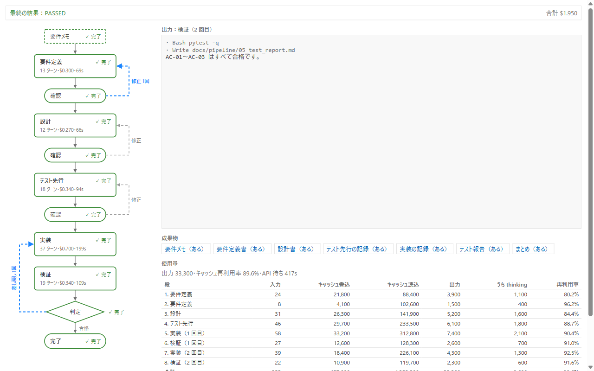

<h1>
  <picture>
    <source media="(prefers-color-scheme: dark)" srcset="docs/assets/pipe-in-logo-dark.svg">
    
  </picture>
</h1>

pipe-in は、要件メモから **要件定義 → 設計 → テスト先行 → 実装 → 検証** を Claude Agent SDK（Python）で順に流し、段の区切りで人が確かめながら進める道具です。

<picture>
  <source media="(prefers-color-scheme: dark)" srcset="docs/assets/run-panel-dark.png">
  
</picture>

<sub>VSCode の拡張のパネル。見本の記録（数字は見本）を拡張の本物の画面で写したもの。</sub>

- 段の区切りで止まり、人が 承認 / 修正を依頼 / 中止 を選びます。→ [使い方](docs/guide/usage.md)
- テストを先に書かせて赤を確かめ、検証で不合格なら実装へ差し戻します（既定で最大3回）。→ [開発フローの流れ](docs/guide/usage.md#開発フローの流れ)
- 段ごとに書ける範囲を決め、範囲外の書き込みや危ない操作は止めます。→ [安全のしくみ](docs/guide/safety.md)
- 進み具合と使用量を VSCode のパネルで図として見られます。パイプは作業台で組み立てます。→ [VSCode の拡張](docs/guide/vscode.md)
- 段の並びを自分で決めた「パイプ」を作って流せます（図を作る・仕様とソースの突き合わせなど）。→ [パイプ](docs/guide/pipes.md)
- 費用・トークン・利用枠を、段ごとに記録に残します。→ [記録と使用量](docs/guide/records.md)

**目次**：[すぐ試す](#すぐ試す) · [文書](#文書) · [前の名前から移る](#migrate) · [ライセンス](#ライセンス)

## すぐ試す

### 必要なもの

- Python 3.11 以上
- Claude Code にログイン済み（`claude` で一度ログイン）か、`ANTHROPIC_API_KEY` を設定済み
- 対象プロジェクトは git 管理下で、作業用ブランチにしておくのがおすすめです

### 入れる

```bash
# リポジトリを手元に写す
git clone https://github.com/nigoh/pipe-in.git
cd pipe-in

# 仮想環境を作る
python -m venv .venv
# 仮想環境に入る（どちらか1つ）
. .venv/Scripts/activate        # Windows の Git Bash
source .venv/bin/activate       # macOS / Linux

# 入れる
pip install -e .                # pipe-in と pipe-in-gen が入る
```

前の名前のころに入れていたときは、[前の名前から移る](docs/guide/migrate.md)の手順で入れ直してください。

### 最初の1回

```bash
# 対象のプロジェクトで、要件メモから開発フローを流す
pipe-in --project ~/src/myapp --text "ユーザー一覧に CSV 出力ボタンを追加したい"
```

要件定義のあとで止まり、文書の先頭を見せて確認を求めます（[確認の画面](docs/guide/usage.md#確認の画面)）。記録は対象の `docs/pipeline/` に残ります（[作られるファイル](docs/guide/records.md#作られるファイル)）。

> [!IMPORTANT]
> 段ごとに Claude Agent SDK を呼ぶので、利用料がかかります。対象は git 管理下にして、作業用のブランチで流してください。

## 文書

くわしい説明は `docs/guide/` にあります（目次：[docs/guide/README.md](docs/guide/README.md)）。

| 文書 | 中身 |
| --- | --- |
| [使い方](docs/guide/usage.md) | 開発フローの流れ・流す・途中から再開・確認の画面・`--pause` と `--review`・`pipe-in record`・注意 |
| [VSCode の拡張](docs/guide/vscode.md) | 入れ方・実行を見る・パイプ作業台 |
| [パイプ](docs/guide/pipes.md) | 作り方・ひな形・見本のパイプ・`pipe.toml`・検証と差し戻し・分岐・Agent SDK の設定 |
| [Claude Code のプラグイン](docs/guide/plugin.md) | 入れ方・入るもの（`/pipe-in:pipe-build`・pipe-builder・検査と審査のスキル・フック） |
| [安全のしくみ](docs/guide/safety.md) | 段ごとの書き込める範囲・どの段でも止める操作 |
| [記録と使用量](docs/guide/records.md) | 作られるファイル・まとめに出る使用量・終了コード |
| [設定](docs/guide/config.md) | `pipeline.toml` |
| [前の名前から移る](docs/guide/migrate.md) | 入れ直す・古いコマンド・プラグイン・拡張・置き場所・環境変数 |
| [pipe-in を開発する](docs/guide/develop.md) | 中身を直したいとき・Claude Code で開発するとき |

拡張のくわしい操作は [vscode/README.md](vscode/README.md)、開発のルールは [docs/development/](docs/development/)、機能ごとに決めたことは [docs/decisions/](docs/decisions/) にあります。

<a id="migrate"></a>

## devpipe から移る

この道具の名前は devpipe から pipe-in に変わりました（0.3.0）。前の版を使っていたときの手順は [docs/guide/migrate.md](docs/guide/migrate.md) にあります。

## ライセンス

MIT（[LICENSE](LICENSE)）
