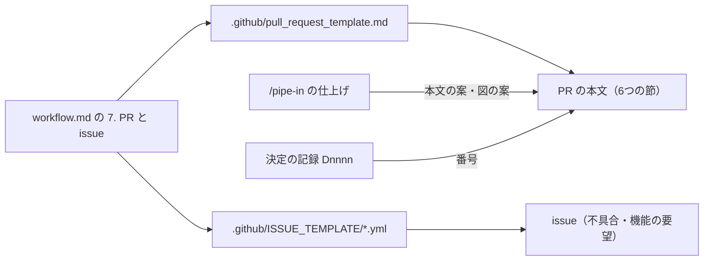

# D0058 PR と issue の決まりと形（テンプレートと Mermaid の図）

## 目的

PR と issue を、あとから記録として読み返しやすい形にそろえる。これまで PR の本文と issue の形に決まりが無く、何を変えたか・どの決定の記録の話か・何を確かめたかが PR ごとにばらばらだった。GitHub の公式の置き場所にテンプレートを置き、決まりを `docs/development/workflow.md` に書く。流れや依存の向きは、GitHub が描く Mermaid の図で見せられるようにする（任意）。

## 機能要件と受け入れ基準

### 機能要件

- FR-01：PR のテンプレート `.github/pull_request_template.md` を置く。
- FR-02：PR の本文は「何を変えたか」「なぜ（決定の記録・関わる issue）」「受け入れ基準と確かめたテスト」「確かめたこと（テスト・手で・実機）」「図（任意）」「公開してよいかの確認」の6つの節をこの順で持つ。
- FR-03：issue は issue forms（`.github/ISSUE_TEMPLATE/*.yml`）で「不具合」と「機能の要望」の2つを出す。
- FR-04：不具合の form は起きたこと・期待したこと・再現の手順・触る側・版や環境の欄を、機能の要望の form は困っていること・してほしいこと・対象外にしてよいこと・触る側の欄を持つ。
- FR-05：`.github/ISSUE_TEMPLATE/config.yml` で白紙の issue を許す。
- FR-06：テンプレートと forms に、秘密と手元の事情を書かない注意書きを入れる。
- FR-07：Mermaid の図は任意とし、勧める場面（変更の流れ・依存の向きや層・段や状態の移り変わり）を決まりに書く。PR のテンプレートに見本を1つ置く。
- FR-08：PR のタイトルは、そのコミットの1行目と同じ形にする。
- FR-09：issue forms が付けるラベルは、GitHub の既定の `bug`・`enhancement` だけにする。
- FR-10：決まりを `docs/development/workflow.md` の「7. PR と issue」に書き、`design.md` の置き場所の表と `CLAUDE.md` に案内を足す。
- FR-11：`/pipe-in` の仕上げで、コミットの文の案と一緒に、PR のテンプレートに沿った PR の本文の案（向く変更なら Mermaid の図の案も）を見せる。
- FR-12：テンプレートの形を pytest で検査する。

### 受け入れ基準

- D0058-AC-01：PR のテンプレートがあり、6つの節がこの順で出てくる。（tests/test_github_templates.py）
- D0058-AC-02：「なぜ」の節に、決定の記録の番号と関わる issue を書く場所がある。（tests/test_github_templates.py）
- D0058-AC-03：「受け入れ基準と確かめたテスト」の節に、AC・確かめたテスト・結果の表のひな形がある。（tests/test_github_templates.py）
- D0058-AC-04：「図（任意）」の節に、Mermaid の見本が1つ、丸ごと HTML のコメントの中にある。（tests/test_github_templates.py）
- D0058-AC-05：不具合と機能の要望の form が1つずつあり、`markdown` 以外の欄は重ならない `id` を持ち、`markdown` の欄は `id` を持たない。ラベルは `bug`・`enhancement` だけ。（tests/test_github_templates.py）
- D0058-AC-06：不具合の form の起きたこと・再現の手順、機能の要望の form の困っていること・してほしいことが必須。不具合の form に期待したことの欄がある。（tests/test_github_templates.py）
- D0058-AC-07：どちらの form にも、触る側を選ぶ欄があり、本体・ジェネレーター・プラグイン・拡張・文書が選べる。（tests/test_github_templates.py）
- D0058-AC-08：`config.yml` が白紙の issue を許す。（tests/test_github_templates.py）
- D0058-AC-09：PR のテンプレートとどの form にも、秘密と手元のパスの注意書きがある。（tests/test_github_templates.py）
- D0058-AC-10：足したファイルに手元の事情が入っていない。（既存の tests/test_rules.py）
- D0058-AC-11：`workflow.md` に「7. PR と issue」の節があり、タイトル・テンプレートの場所・mermaid・任意・秘密の語がある。（tests/test_github_templates.py）
- D0058-AC-12：Mermaid の決まりに図を勧める場面があり、`specs.md` の決定の記録の節にも図は任意とある。（tests/test_github_templates.py）
- D0058-AC-13：`design.md` の置き場所の表にテンプレートの行がある。（tests/test_github_templates.py）
- D0058-AC-14：`CLAUDE.md` に「7. PR と issue」への案内がある。（tests/test_github_templates.py）
- D0058-AC-15：`/pipe-in` の仕上げに PR の本文の案を見せる手順があり、push は人に言われてからの文が残る。（tests/test_github_templates.py）
- D0058-AC-16：古い形の扱い。すでにある PR・issue・決定の記録・記録・設定・置き場所は変わらず、図の無い決定の記録もこれまでどおり通る。（既存の tests/test_rules.py と、検証の段の git の確かめ）
- D0058-AC-17（実機）：GitHub で新しい PR を開くと本文にテンプレートが入り、見本の図が Mermaid の図として描かれる。（まだ）
- D0058-AC-18（実機）：GitHub の「New issue」で2つの form と白紙の issue が選べ、決めたラベルが付く。（まだ）

## 決めたことと理由

PR と issue が、どのファイルから何を受け取るかの図（この記録でも図を使う見本として置く）。

### 人が決めたこと（要件定義と設計で聞いた点）

- 置き方：GitHub の公式の仕組みを使う。issue は入力欄つきの issue forms にする。
- 言葉は日本語だけにする。
- issue の種類は不具合と機能の要望の2つにし、白紙の issue も許す。
- Mermaid の図は任意にする。勧める場面を決まりに書き、決定の記録でも勧める（`specs.md`）。記録の形の検査は変えないので、図の無い記録もこれまでどおり通る。
- ラベルは GitHub の既定の `bug`・`enhancement` だけにし、新しいラベルは作らない。
- `/pipe-in` の仕上げで、コミットの文の案と一緒に PR の本文の案を見せ、図が向く変更なら Mermaid の図の案も入れる。
- 見本の図は PR のテンプレートの HTML コメントの中に置く。決まりは `workflow.md` に「7. PR と issue」として足す。
- スキルの字数の上限（合計 18,300 字・SKILL.md 12,300 字）は変えない。足しても収まることを数えて確かめた。
- AC-05 は「`markdown` 以外の欄は `id` を持ち、`markdown` は持たない」と読み替える（GitHub の form の決まりで、`markdown` の欄は `id` を持たないため）。ラベル・期待したことの欄・決定の記録の図は、ID を増やさず AC-05・06・12 に含める。
- 監査と助言で人が承認して直した項目：
  - A-01：PR のタイトルは、コミットの1行目に決定の記録の番号を（Dnnnn）として付けた形にする。コミットでは番号を本文に書くが、PR の一覧では題しか見えないため。前の PR #94 もこの形だった。
  - A-02：Dependabot の PR は、タイトルも本文もこの形に沿わなくてよい。
  - A-03：文書の誤りは不具合、文書を足す・書き直すのは機能の要望で出し、白紙の issue は質問などに使う。
  - A-04：公開の注意の言い方を、principles.md の「社内や私的なプロジェクトの名前」にそろえ、issue forms にも入れる。
  - A-05：`pytest -q` は文書だけの変更でも流す、と理由を添える。
  - V-01：`.claude/settings.json` の `ask` に `Bash(gh pr create:*)`・`Bash(gh pr merge:*)` を足す。「PR を出すのは人に言われてから」の決まりを、確認でも支えるため。止める範囲は広がるだけで、狭めていない。
  - V-02：SKILL.md の冒頭の「必ず守ること」に「PR を出す」を入れる。自動の要約のあとに戻るのはスキルの先頭だけなので。
  - V-03：Claude Code が PR の本文の終わりに足す「🤖 Generated with Claude Code」の行は残すと、`workflow.md` に書く（設定の `attribution` は変えない）。

### 聞かずに決めたこと

- 不具合の form の触る側の選択肢に、5つの側に加えて「分からない」を置く（出す人が迷わないように）。
- `config.yml` には `blank_issues_enabled: true` だけを書き、`contact_links` は置かない（案内する外の場所が無いため）。
- コメントの中の見本の図では、矢印を `==>` で書く。細い矢印 `-->` は HTML コメントの終わりの印と同じ文字なので、そこでコメントが終わってしまう。この記録のようにコメントの外に置く図では、細い矢印を使ってよい。
- テンプレートの形の検査は、新しい `tests/test_github_templates.py` で行う。YAML は依存を足さず、`tests/test_ci_workflow.py` の小さな読み手で読む。
- main に載せ直したとき、main に D0055（Dependabot）・D0056・D0057 が先に入っていたので、この記録を D0055 から D0058 に付け替え、AC の ID とテストの名前もそろえた。`CLAUDE.md` の「必ず守ること」は、main が足した質問欄（AskUserQuestion）の行と、この記録で直したコミットの行の両方を残した。`.claude/settings.json` の `ask` は、main が足した `gh issue create` と、この記録の `gh pr create`・`gh pr merge` の両方を残した。
- 新しいファイルは `git add -N` で追跡に入れ、`test_no_local_info_in_tracked_files` の範囲に入ることを確かめた。

### 受け入れたリスク

- テストが見るのは形と語だけで、GitHub が実際にテンプレートを読めるかは見ない（AC-17・18 の実機で見る）。
- `ask` は守りの境目ではない（`gh -R … pr create` のような別の書き方には当たらない）。目安として扱う。
- main に載せ直したら、main 側の質問欄の決まりと合わせてスキルの合計が上限を 21 字超えたので、この記録で足した文を詰めて、ちょうど 18,300 字に収めた。残りは 0 字なので、次にスキルへ足すときは、補助ファイルに分けるか、上限を上げるかを決める。

### 確かめていないこと

- D0058-AC-17（実機）：GitHub で PR を開くと本文にテンプレートが入り、見本の図が描かれるか。まだ。この変更の PR を出してから確かめる。
- D0058-AC-18（実機）：「New issue」で2つの form と白紙の issue が選べ、ラベルが付くか。まだ。issue forms は既定のブランチにあるものだけが使われるので、main に入れてから確かめる。
- `gh pr create` の `ask` で、実際に確認が出るか。実機ではまだ確かめていない。

## 対象外・残った課題

- GitHub の設定そのもの（ラベルを API で作る・ブランチの保護）と、すでにある PR・issue の書き直しは対象外。
- A-06：`workflow.md` の「5. 終える」は「早送りだけ。マージのコミットは作らない」と書くが、GitHub で PR をマージしたときにはマージのコミットができている。前からある運用と文書のずれなので、別の `docs/` のブランチで扱う。
- V-04：Claude Code がリポジトリの PR テンプレートを読むかどうかは、公式の文書に書かれていない。なので、節の順はスキルにはっきり書いた。
- V-05：PR に結び付いた会話を `claude --from-pr <番号>` で探せることを書き添える件と、スキルを補助ファイルに分ける件は、まだしていない。
- `python -m pipe_in skill worktree sync` が、この手元の環境（Windows）で `git log` の出力を読めずに落ちた（`stdout` が None）。日本語のコミットの文の文字コードが原因と見ている。今回は `git rebase --autostash main` を手で流した。別の `fix/` のブランチで直す。
- 手元の環境で全体の `pytest -q` を流すと、`tests/test_bash_write_guard.py` の一時の場所・`/dev/…` の行 48 件と、`tests/test_live_answer_cli.py` の lookalike-42 の1件が落ちる。このブランチはそれらのファイルに触れていない。CI で同じく落ちるかを PR で見る。

## 確かめたこと

- `tests/test_github_templates.py` の 27 件は、テスト先行で 22 件が期待した理由（ファイル・節・語が無い）で落ちることを確かめ、実装のあとはすべて通った。
- 監査と助言の直しのあと、`tests/test_github_templates.py`・`test_rules.py`・`test_guide.py`・`test_readme.py`・`test_ci_workflow.py`・`test_skill_tidy.py`・`test_skill_tidy_docs.py`・`test_architecture.py` の 789 件がすべて通った。
- 全体の `pytest -q` では、上の既存の 49 件だけが落ち、それ以外は通った（11660 件）。
- 検証の段で、テンプレートの中身（Mermaid の文法、issue forms の形、dropdown の選べるもの）も読んで確かめた。
- 監査は 6 件、助言は 5 件だった。助言の報告の審査は overall 0.85・pass。減点は、言いすぎが1つと、Mermaid の図の案を照らしていないことだった。
- 実機（AC-17・18）はまだ。
- 見落とし：`ask` に2つを足したことで、`tests/test_wait_notify.py` の D0046-AC-27（`ask` の一覧が決まった形のままかを見る検査）が落ちていた。手元では、関わりの無い 49 件の失敗の中に紛れて気づかず、PR #102 の CI で分かった。あとの `fix/settings-ask-test` で、D0056 のときと同じく期待の一覧に2つを足した。手元の 49 件は CI では落ちなかったので、手元の環境だけで起きるものと分かった。
