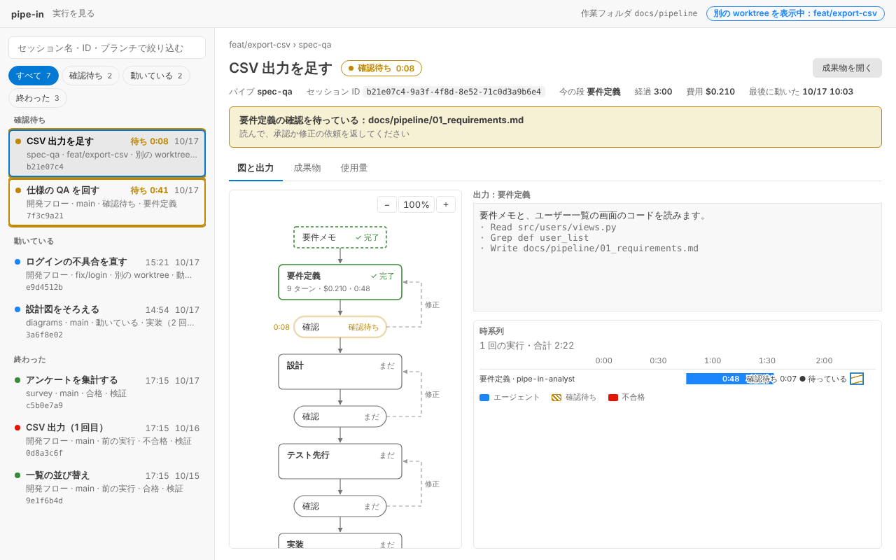
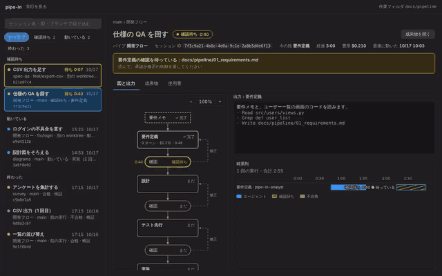

# VSCode の拡張

[ガイドの目次](README.md) · [README](../../README.md) — 実行を図で見るパネルと、パイプを組み立てる作業台の説明です。

<picture>
  <source media="(prefers-color-scheme: dark)" srcset="../assets/run-panel-dark.png">
  
</picture>

<sub>VSCode の拡張のパネル。見本の記録（数字は見本）を拡張の本物の画面で写したもの。</sub>

`vscode/` にある拡張で、実行の進み具合をパネルに図として見たり、パイプを作業台で組み立てたりできます。拡張は記録を読むだけで、記録には何も書きません。くわしい使い方は [vscode/README.md](../../vscode/README.md) にあります。

```bash
# 拡張を作って、普段の VSCode に入れる
cd vscode
npm install
npm run package                                        # pipe-in-vscode.vsix ができる
code --install-extension pipe-in-vscode.vsix --force
```

## 実行を見る

コマンドパレットの「pipe-in: 実行を見る」か、ステータスバーの `pipe-in` のボタンでパネルが開きます（冒頭の画像。ボタンの文字は [ステータスバー](#ステータスバー) の節）。

パネルは Web アプリのような 3 つの領域です。**上に細いバー、左に実行の一覧、右に選んだ実行の詳細**。見られる実行が 1 つでも 0 でも、同じ形で出ます（0 のときは一覧に「実行がありません」と出ます）。

- 上のバー：`pipe-in`、作業フォルダ（設定 `pipe-in.workDir` の相対パスのまま）。別の worktree の実行を選んでいるときだけ、「別の worktree を表示中：ブランチ名」の印が付きます。
- 左の一覧：絞り込みの入力、状態のタブ、状態ごとの見出しで分けた行。
- 右の詳細：パンくず、見出し（セッション名と状態）、「成果物を開く」ボタン、メタ（パイプ・セッション ID・今の段・経過・費用・最後に動いた時刻）、タブ「図と出力」「成果物」「使用量」。

図は元の大きさで描き、枠に収まらない分は枠の中でスクロールします。時系列は枠の幅に合わせて帯が伸び縮みします（文字は縮まない）。図は、Ctrl（mac は ⌘）を押しながらホイールを回すか、図の枠の右上の「−」「100%」「＋」のボタンで、50% から 200% まで 10% ずつ拡大・縮小できます（「100%」を押すと元の大きさに戻ります）。倍率はパネルを開いている間だけ覚えていて、実行を選び替えても変わりません。

`pipe-in --pipe` で流したパイプの記録も、開発フローと同じ一覧に並びます。

### 実行の一覧

<picture>
  <source media="(prefers-color-scheme: dark)" srcset="../assets/run-list-dark.png">
  
</picture>



左の一覧は、1 行に 1 つの実行です。行は 3 行の中身です。

1. セッション名（太字）。右に、確認待ちなら待ち時間、動いている・終わった実行なら経過、そして最後に動いた日付。
2. パイプ名 · ブランチ · 状態 · 今の段（別の worktree の行には「別の worktree」、`archive/` の行には「前の実行」の印も付く）。
3. セッション ID の先頭 8 文字（等幅。無ければ「—」）。

行を押す（Tab で移って Enter・Space でも）と、右の詳細がその実行に切り替わります。いま見ている行は背景と枠で強調して出ます。

- **セッション名**は、実行を始めるときに付けます（`pipe-in --name "…"`、`pipe-in record start --name "…"`）。付けなかったときは、要件メモの最初の行（先頭の `#` を取り、60 文字まで）から作ります。それも取れない古い記録では、パイプ名（開発フローは「開発フロー」）を出します。**セッション ID** は `pipe-in record start --session-id` で付けた ID。パイプの記録は、最後に動いた段の会話の ID を出します（段ごとに Claude の会話が別なので、`/pipe-in` を動かしている会話の ID とは別物です）。どちらも無ければ「—」です（[記録](records.md)）。
- **絞り込み**：入力した文字が、セッション名・セッション ID（全部）・ブランチ名のどれかに含まれる行だけが残ります（大文字小文字は区別しません）。どの行も残らないときは「該当する実行がありません」と出ます。
- **状態のタブ**：すべて・確認待ち・動いている・終わった。それぞれ件数が付き、押した状態の行だけを見せます。「動いている」には「待ち」の行も入ります。件数は絞り込みの文字に関わりません。絞り込みとタブはパネルの中だけで決め、パネルを開き直すと初めに戻ります（選んだ実行だけを覚えます）。
- 状態は 4 つです。**確認待ち**（人の確認で止まっている）・**動いている**・**待ち**（確認待ちでも動いてもいない。段の合間や、記録がまだ無いとき）・**終わった**（合格・不合格・中止・段が失敗・実行できず のどれか）。図の帯とステータスバーと同じ判定です。
- 並びは、確認待ち → 動いている → 待ち → 終わった の順で、同じ状態の中は最後に動いた時刻が新しい順です。行を選んでも並びは動きません。
- 確認待ちの行は、黄色の枠と「確認待ち」の文字で目立ち、待ち時間が 1 秒ごとに増えます。動いている行の経過も 1 秒ごとに増えます。OS の「動きを減らす」設定のときは点滅が止まり、枠と文字で分かります。
- 同じ git リポジトリの別の worktree の実行も、同じ一覧に出ます。ブランチ名はいまの work_dir の行にも付きます（detached HEAD は短い ID。git の外ではブランチの項目ごと出しません）。別の worktree は、`.git` の中の worktree の登録を読んで見つけます（git のコマンドは動かしません）。登録されたフォルダが実在し、その worktree の `.git` が自分の登録を指し返し、`pipe-in.workDir` の設定がその worktree の中に収まるものだけを読みます。読むのは `state.json`・`logs/`・成果物の一覧にあるもの・`00_input.md` の先頭だけです。更新が新しい方から 8 個までで、超えた分は「別の worktree を N 個、省いています」と出ます。
- 終わった開発フローの記録が移される `archive/` の中の実行も、「前の実行」の印を付けて出ます。場所ごとに新しい方から 10 件までで、超えた分は「古い実行を N 件、省いています」と出ます。
- 選んだ実行はワークスペースごとに覚え、パネルを閉じて開き直しても、VSCode を開き直しても戻ります。覚えた実行が見つからないとき（消えた・worktree が無くなった）は、いまの work_dir の最新の実行を見ます。`pipe-in.workDir` を変えたときも、覚えた実行が新しい work_dir の候補に当てはまらなければ使わず、同じく最新の実行を見ます。覚えるのは VSCode が拡張に用意する保存場所だけで、work_dir・プロジェクト・worktree には何も書きません。
- いまの work_dir の実行は、今までどおり記録が変わるとすぐに描き直されます。
- 別の worktree の行があるあいだは、パネルが閉じていても隠れていても約 5 秒ごとに読み直すので、反映が最大で 5 秒ほど遅れます（ステータスバーの件数のためです。[ステータスバー](#ステータスバー)）。
- 別の worktree の行が無いときは、パネルが見えている間だけ読み直します。`archive/` の行があるか、選んだ実行が動いている・確認待ちのときに、約 5 秒ごとです（時系列の帯を伸ばすためです）。どちらも無ければ読み直しません。隠れたパネルがまた見えたときは、1 回すぐ読み直します。
- 選んだ実行が別の worktree にあれば、ステータスバーもその実行を出します（件数の形のときは、説明の「選んでいる実行」の行に出ます）。
- 別の worktree を出したくないときは、設定 `pipe-in.showOtherWorktrees` を切ります（既定は出す）。切ると、いまの work_dir の実行だけになり、ステータスバーの件数と、パネルを閉じている間の読み直しにも効きます。
- 注意：パイプの名前が `archive` だと、`archive/` が記録の移し先と区別できません。拡張は `archive` をパイプのフォルダとして数えません（本体がこの名前を止めていないのは、残る課題です）。

### 詳細

- 見出しの横のバッジが状態です。確認待ちなら「確認待ち 0:08」のように待ち時間が付きます。確認待ちのときは、何の確認を待っているかと文書の場所が黄色の知らせで出ます（読んで、承認か修正の依頼を返します）。
- 「成果物を開く」ボタンは、下のタブ「成果物」に切り替えます。
- 下のタブは「図と出力」「成果物」「使用量」。初めは「図と出力」です。切り替えはパネルの中だけで決めます。
- 「図と出力」は、左に段の図（要件メモ → 要件定義 → 確認 → … → 完了。動いている段・確認待ち・差し戻しの回数が出ます）、右の上に、いま見ている段の出力、右の下に**時系列**です。一覧・図の枠・出力・時系列は、それぞれ別にスクロールします。
- 差し戻しや修正の依頼があった節（実装・判定・確認）は押せます。押すと、図の枠の理由の欄に何回目に・なぜ戻ったか（検証の不合格の理由や、修正の依頼の内容）が出ます。もう一度押すと閉じます。キーボード（Tab と Enter・Space）でも選べます。
- 「成果物」は成果物の一覧（押すとエディタで開く）、「使用量」は段ごとのトークン・モデル別・利用枠です。
- 描き直しがあっても、絞り込みの文字・タブの選び・理由の欄の選び・スクロールの位置・入力の焦点は消えません。日本語入力の変換中は、変換が終わるまで描き直しを待ちます。選んだ実行を替えたときは、図の枠・出力・時系列を先頭に戻します（一覧の位置は残ります）。

### 時系列

段の実行 1 回ごとに 1 行を、実行の順に並べます。行の名前は「段 回 · 受け持ち」（受け持ちは `record begin --agent` で残した名前。SDK で流した段と古い記録には付きません）です。

- 青い帯が、エージェントが動いた時間です。動いている段は「今」まで伸び、外側に輪と「● 動いている」が付きます。
- 斜線の帯が、人の確認を待った時間です。段の実行が終わってから、次の実行が始まるまで（最後の確認は記録の更新時刻まで。確認の結果の時刻は記録しないので、実際より少し長く出ることがあります）。いま待っている帯には、輪と「● 待っている」が付きます。確認を取らない段（`--yes`）には出ません。
- 赤い帯は、失敗した段か、判定が不合格・実行できずの検証です。色のほかに「✕」でも分かります。
- 横軸は、実行の始まりからの時間（`m:ss`、1 時間以上は `h:mm:ss`）です。段の始まりの時刻が読めない段（古い記録）は、行だけ出して「時刻の記録なし」と書きます。時刻が 1 つも読めないときは「時刻の記録がありません」と出ます。
- 行は 200 までで、超えるときは古い方を省いて「前の N 行を省いています」と出ます。時系列は枠の幅に合わせて帯が伸び縮みします（文字は縮まないので、読みにくくなりません）。

### 時間と動き

- 動いている段の節には「経過 1:23」のような時間が出て、1 秒ごとに増えます。全体の経過は、詳細のメタの「経過」に出ます（動いている・確認待ちの実行は数え上げ、終わった実行は固定の時間）。
- 人の確認を待っているときは、確認の節が黄色で点滅し、左に待ち時間が出ます（待ち時間は段の時間には入れません）。
- 終わった段の節には、かかった時間の合計（`m:ss`、1 時間以上は `h:mm:ss`）が出ます。差し戻しや修正でやり直した段は、図の枠の「時間」に 1 回目・2 回目と合計が並びます。
- 動いている段の枠はゆっくり光り、その段へ入る矢印の上を点が流れます。差し戻しや修正の依頼が新しく起きたときは、戻る矢印が一度だけ強く光ります。
- OS の「動きを減らす」設定のときは、動きはすべて止まります（時間の数え上げは続き、状態は色・枠・文字で分かります）。パネルが見えていないあいだは数え上げを止め、戻ると正しい時間に直ります。
- 時間は、記録に書かれた始まりの時刻（段のログの `at`、確認待ちの `since`）から出します。これらが無い古い記録では、数え上げは出さず、終わった段の時間だけを出します（[記録](records.md)）。

### 止まっているかもしれない実行

端末を閉じた・処理が落ちたなどで途中で止まった実行は、記録の上では「動いている」のままです。段のログが決まった時間動かない実行には、「動いている」のまま印を添えます。

- **何を見るか**：動いている実行の**段のログ**（`logs/NN_<段>.jsonl`）の**更新時刻**（ファイルの更新時刻）です。その実行の全ログのうち、いちばん新しいものを「最後の更新」とします。再開で古い途中のログが残っていても、新しいログが動いていれば印は出ません。
- **いつ出るか**：最後の更新から**目安の時間**（既定は 10 分）がたつと、次の印が一度に出ます。
  - 図：動いている段の節が点線の枠になり、「⚠ 更新なし 12:00」と更新されていない時間が 1 秒ごとに増えます。節の脈打ちと、入る矢印の点が止まります。
  - 一覧：動いている行が点線の枠になり、3 行目（セッション ID の行）の右に「⚠ 更新なし」と時間が出ます。
  - 詳細：状態のバッジ「動いている」の隣に「⚠ 止まっているかも」と、メタの下に知らせ（ログが更新されていない時間）が出ます。
  - 時系列：動いている帯に「● 動いている ⚠ 更新なし」が出て、輪が点線になります。
  - どれも状態の言葉は「動いている」のままです。動きを減らす設定でも印は出ます。
- **目安の変え方**：設定 `pipe-in.staleAfterMinutes`（分。整数）。0 で印を出しません。上限は 10080 分（7 日）で、それより大きい値は 10080 分として扱います。小数・文字・負の値など、0 以上の整数でない値は、既定の 10 分に戻ります。設定を変えると、パネルを開いたままでも目安が変わります。
- **何を意味しないか**：「止まった」と決めるものではなく、「止まっているかも」の知らせです。プロセスは調べません（拡張は work_dir を読むだけです）。ログの更新時刻は粗い信号で、動いていても印が出ることがあります。
  - SDK で流す段でも、長いコマンドや長い考え中の静かな段は、ログがまとめて書かれるので、しばらく更新されません。
  - `/pipe-in` の段（`pipe-in record` 経由）は、`record begin` と `record done` のあいだ何も書きません。目安より長い段は、動いていても印が出ます。
  - 長い段を流すときは、目安を延ばすか 0 にして切ってください。
  - 記録を書いた機械と見る機械の時計が違う（共有フォルダなど）と、ずれた分だけ誤って出たり、出るはずが出なかったりします。更新時刻が今より先のときは 0 秒として扱い、印は出ません。
- **「最後に動いた」との違い**：詳細のメタの「最後に動いた」は、`state.json` の更新時刻で、段が終わった時刻です。段のあいだは進みません。印はログの更新時刻で決めるので、別のものです。
- **出ない場合**：動いていても止まっていても、次のときは印が出ません。
  - 最初の段のあいだ（`state.json` がまだ無く、一覧に行もありません）。
  - 終わった記録が残る work_dir で再実行（流し直し）したときの、最初の段のあいだ（前の記録が残っていて、新しいログが「動いている」と見なされません）。
  - 起動直後で、ログがまだ空のあいだ。
  - 並列のグループで、あとの段が先に終わったあと（残りの動いている段が「動いている」の判定から外れ、実行は「待ち」になります）。
  - 更新の新しい方から 8 個を超えて省いた別の worktree と、件数を超えて省いた `archive/` の実行。
  - 動いている段のログの更新時刻が読めないとき（ほかのログの時刻で代わりにしません）。
  - 確認待ち・待ち・終わった・前の実行（`archive/`）の行、`state.json` が読めない実行。
- **いつ消えるか**：ログが更新されて描き直されたときです。いまの work_dir の実行は、記録が変わるとすぐ消えます。別の worktree の行は、約 5 秒ごとの読み直しで消えます（最大で 5 秒ほど遅れます）。

### ステータスバー

ウィンドウ下のステータスバーの `pipe-in` のボタンは、ふだんは選んでいる実行の今の段や結果（「設計」「合格」など）を出します。選んでいる実行のほかに、動いている・確認待ち・待ちの実行があるときは、代わりにその件数を出します。並列に流している実行や、別の worktree の確認待ちに、パネルを開かなくても気づけます。

- **選んでいる実行**：パネルかボタン（とコマンド）で選んだ実行です。選びが無ければ、いまの work_dir でいちばん新しく更新された実行（`archive/` を除く）です。
- **いつ件数になるか**：選んでいる実行のほかに、動いている・確認待ち・待ちの実行が 1 つでもあるときだけ、件数の形になります。無いとき（実行が 1 つだけ・ほかは全部終わっている・`archive/` の行だけ・記録がまだ無い、など）は、今までどおりの出し方です。選んでいる実行が合格や不合格で終わっていても、ほかに確認待ちがあれば件数の形になります。
- **文字**：`pipe-in: 動き 2・確認待ち 1` のように、動き → 確認待ちの順に並べます。0 の項目は出しません。アイコンは、数えた実行の状態のうち、確認待ち ＞ 動いている ＞ 待ち の順に優先したものです（確認待ちがあれば会話のアイコン、なければ回る矢印、待ちだけなら時計。今までの出し方と同じアイコンです）。
- **数える範囲**：実行の一覧の行から数えます。
  - いまの work_dir（直下の開発フローと、`<work_dir>/<パイプ名>/` のパイプ）と、別の worktree の実行を、同じに数えます。別の worktree は、更新が新しい方から 8 個までです。超えて省いた分は数えず、説明に省いた個数が出ます。
  - 選んでいる実行も、数える状態（動いている・確認待ち・待ち）なら数に入ります。`動き 2` は、選んでいる実行を含む数です。
  - `archive/` の実行と、終わった実行（合格・不合格・中止・段が失敗・実行できず）は入りません。
  - 待ちの実行は「動き」に入ります（一覧のタブ「動いている」と同じ数え方です）。
  - 止まっているかもしれない実行（[上の節](#止まっているかもしれない実行)）も「動き」に入ります。印はステータスバーには出しません。
  - 動いている段と確認待ちの印が同じ記録に同時にある実行（並列の段が動いているあいだなど）は、一覧の状態と同じく「動き」で、「確認待ち」には入りません。
- **説明（マウスを重ねると出る文字）**：件数の形のときは、次の行が並びます。
  - 1 行目：`pipe-in：動き 2・確認待ち 1`。
  - 数えた実行を 1 行ずつ：`確認待ち：画面を直す（要件定義・feat/status-counts）` のように、状態・セッション名・今の段・ブランチ名です（ブランチ名は git の外では省きます）。一覧と同じ並びで、10 件までです。超えたら「ほか N 件（パネルの一覧で見られます）」と出ます。確認する文書の場所は出しません（パネルの詳細で見ます）。
  - 別の worktree を省いているとき：「別の worktree を N 個、省いています（件数に入っていません）」。
  - `選んでいる実行：セッション名（状態）`。選んでいる実行が終わった実行でも、ここで結果（合格など）が読めます。選んでいる実行の記録がまだ無いときは、`選んでいる実行：記録なし` と出ます。
  - `利用枠：5時間枠 2%・7日枠 15%`。選んでいる実行の記録に使用量があるときだけ出ます。
  - 最後に `クリックでパネルを開く`。
- **外から来た文字**：セッション名・今の段・ブランチ名は、改行などの制御文字を空白に替え、60 文字までに整えて、1 行で出します。説明は飾りのない文字なので、名前に書いた `**太字**` のような記号は、そのまま文字として出ます。
- **ボタンの動き**：選んでいる実行が確認待ちでなく、ほかに確認待ちの実行があるときは、ボタンを押すと確認待ちの実行を先に出します。コマンドパレットの「pipe-in: 実行を見る」でも同じです。一覧で先頭の確認待ちを選び、行を押したときと同じように覚えてから、パネルを開きます（パネルがすでに開いていても同じです）。このとき説明の最後は「クリックでパネルを開く（確認待ちの実行を先に出す）」になります。選んでいる実行がすでに確認待ちなら、選びは変えません。別の実行を選び直したあとでも、確認待ちが残っていれば、ボタンを押すとまたそちらへ移ります。
- **選んだ行が隠れるとき**：先に出した実行の行が、パネルの絞り込みの文字や状態のタブ（たとえば「動いている」）で隠れていることがあります。詳細は、その実行に切り替わっています。タブを「すべて」に戻すか、絞り込みを消すと、行が見えて強調されます。
- **パネルを閉じていても読み直します**：別の worktree の行が一覧にあるあいだは、パネルを閉じていても隠れていても、約 5 秒ごとに記録を読み直して、ステータスバーを直します。別の worktree の確認待ちには、最大で 5 秒ほど遅れて気づけます。いまの work_dir の変化は、今までどおりすぐ反映されます。パネルが見えていないあいだは、パネルの中身は作りません。
- **切る設定**：`pipe-in.showOtherWorktrees`（既定は出す）を切ると、別の worktree の実行は一覧にも件数にも入らず、パネルを閉じている間の読み直しも止まります。いまの work_dir の実行（直下とパイプ）は、設定を切っても数えるので、それが複数あれば件数の形になります。件数の形だけを切る設定はありません。
- **限界**：
  - 別の worktree に行がまだ 1 つも無いあいだは、パネルが閉じていると読み直しが動きません。作ったばかりの worktree には work_dir（`pipe-in.workDir`）がまだ無いことが多く、無い worktree は一覧に入らないためです。その worktree で最初の実行（`pipe-in record start` など）を始めたときは、いまの work_dir の記録に変化があるか、パネルを開くまで、ステータスバーは気づきません。その worktree の行が一覧に入ったあと（いまの work_dir の変化・設定の変更・パネルを開くことで読み直されたあと）は、確認待ちに約 5 秒で気づきます。
  - 別の worktree の `state.json` を一時的に読めなかったとき（ファイルを書いている最中など）も、同じです。行が 1 つも読めなかったものとして、パネルが閉じていれば読み直しが止まります。いまの work_dir に変化があるか、設定を変えるか、パネルを開くと、また動き出します。
  - 別の worktree に行があるあいだは、VSCode を開いている間ずっと、約 5 秒ごとに別の worktree（最大 8 個）の記録を読みます。パネルを見ているときと同じ重さです。終わった記録が残っているだけでも続くので、気になるときは `pipe-in.showOtherWorktrees` を切ってください。
  - 件数と、選んでいる実行の図は別に読むので、変わった瞬間に一瞬ずれることがあります。
- **通知ではありません**：音も吹き出しも出さず、ステータスバーに色も付けません。文字と説明が変わるだけです。

### 狭い幅のとき

パネルを横に並べるなどして幅が狭いときは、並びが変わります。

- 幅が 1100px 以下：「図と出力」の中が縦に並びます（図 → 出力 → 時系列）。詳細の枠が縦にスクロールします。
- 幅が 800px 以下：1 列になり、一覧が上、詳細が下に重なります。一覧の高さは画面の約 35% までで、中でスクロールします。ページ全体が縦にスクロールし、横にはスクロールしません。

## パイプ作業台

<picture>
  <source media="(prefers-color-scheme: dark)" srcset="../assets/pipe-editor-dark.png">
  
</picture>

<sub>パイプ作業台。見本のパイプを開き、段「ソースの調査」を選んだところ。</sub>

VSCode 拡張の「pipe-in: パイプ作業台を開く」で、パイプをフロー図として組み立てられます（[vscode/README.md](../../vscode/README.md)）。
形で見分けるブロックを置き、プラグをコンセントに差すようにつなぎ、各ブロックで Claude に頼むことと[パイプの設定](pipes.md#定義の書き方pipetoml)を決めて、`.pipe-in/pipes/pipe-in-<名前>/`（無ければ `pipes/`。前の版のフォルダのパイプは元のフォルダ）に保存します。
