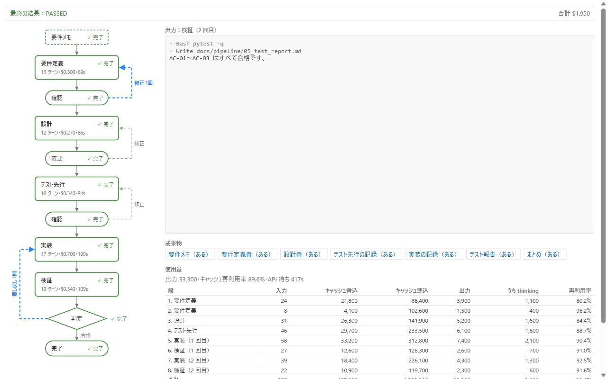
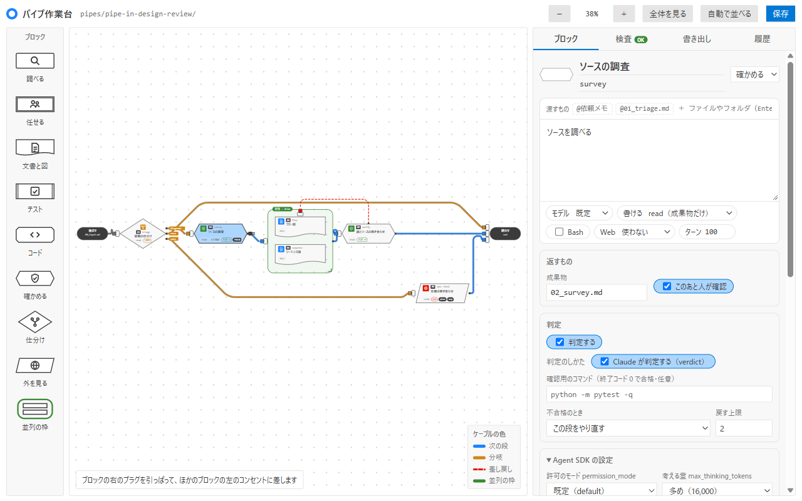

# pipe-in-vscode

[日本語](README.md)

An extension that shows [pipe-in](../README.en.md) runs inside VSCode, as a pipeline diagram and terminal-style output. It also has a workbench for building pipes.
It only reads the records pipe-in writes to the work_dir (`state.json`, `logs/*.jsonl`, and the artifact files), and writes nothing there.
The only things it writes are, when you press "Save" on the workbench, a fixed set of files inside the folder of the pipe you opened (for a new pipe, `.pipe-in/pipes/pipe-in-<name>/`): `pipe.toml`, `prompts/*.md`, `layout.json`, and `README.md` if there is none.
The workbench's saved versions, and the run chosen with the panel or the button (or the command) (`workspaceState`), are written to the storage VSCode gives the extension, not to your project.
It also reads, and never writes, the records of other worktrees of the same git repository and the registrations inside `.git` (it starts no child process).

The steps for moving from the extension under the previous name (settings, commands, removing the old extension) are in the repository's [migration guide](../docs/guide/migrate.md) (Japanese).

There is also a getting-started walkthrough for first-time users. Open "Welcome" in VSCode (the command palette's "Help: Welcome") and choose "pipe-in をはじめる" (Getting started with pipe-in) to follow the steps: install, choose a sample, run, answer the confirmation (it does not open by itself). What you can do without commands is in [the guide for people who do not type commands](../docs/guide/start-without-commands.md) (Japanese).

<picture>
  <source media="(prefers-color-scheme: dark)" srcset="../docs/assets/run-panel-dark.png">
  
</picture>

<sub>The "pipe-in: 実行を見る" (view runs) panel. A sample record (the numbers are samples).</sub>

## Usage

```bash
cd vscode
npm ci               # tools for type checking and building (not needed just for tests)
npm test             # node:test (Node 22 or later)
npm run typecheck
npm run build        # out/extension.cjs
npm run examples:gen # rebuild the examples in src/domain/exampleData.ts from examples/ (only after editing an example)
```

Open this folder in VSCode and start it with F5 (the extension development host). The command palette's "pipe-in: 実行を見る" opens the panel.

### Installing into your everyday VSCode

```bash
npm install
npm run package                                        # pipe-in-vscode.vsix (the build runs here too)
code --install-extension pipe-in-vscode.vsix --force   # code-insiders for Insiders
```

After installing, run "Developer: Reload Window". A `pipe-in` button appears in the status bar at the bottom of the window, and pressing it opens the panel (the command palette's "pipe-in: 実行を見る" does the same). The button's text follows the record (the running stage, waiting, pass / fail, and so on). When there are running, waiting-for-confirmation, or pending runs besides the selected one, it shows counts such as `動き 2・確認待ち 1` (details in the [guide](../docs/guide/vscode.md#ステータスバー), Japanese). If the selected run is not waiting for confirmation and another run is, the button (and the command) selects the waiting run first and then opens the panel.
After a change, install again the same way (`--force` overwrites it even if the version is not raised). To remove it, run `code --uninstall-extension nok.pipe-in-vscode`.

| Setting | Default | Meaning |
| :--- | :--- | :--- |
| `pipe-in.workDir` | `docs/pipeline` | The work_dir, relative to the first folder of the workspace |
| `pipe-in.showOtherWorktrees` | `true` | Also list runs of other worktrees of the same git repository. When off, only runs of the current work_dir. It also affects the count in the status bar and the re-reading while the panel is closed |
| `pipe-in.staleAfterMinutes` | `10` | How many minutes a running stage's log may go without an update before the "⚠ 更新なし" (no update) mark is shown (an integer; 0 shows no mark; the maximum is 10080; any value that is not an integer of 0 or more, such as a decimal, a negative number, or text, is treated as 10) |
| `pipe-in.pipesDir` | `""` | Where the workbench reads and writes pipes. A path relative to the first folder of the workspace, or an absolute path. When empty, `.pipe-in/pipes` and the earlier location |
| `pipe-in.notifyWhenWaiting` | `true` | When a run newly starts waiting for confirmation, show a notice at the bottom right (with a "view runs" button). When off, none is shown. Any value other than `true` / `false` is treated as `true` |

The status bar changes only its text and tooltip, with no color and no sound. The waiting notice is separate, and the setting `pipe-in.notifyWhenWaiting` turns it off. The conditions:
- A run that newly starts waiting for confirmation (including those in other worktrees) is checked at every re-read and announced once. If several start in the same re-read, they are combined into one notice with a count. It is not repeated while the run keeps waiting; waiting → running → waiting shows it again.
- A wait that already exists right after the extension opens is not announced (waits from before opening can be seen in the status bar count). The same applies when you change what you are looking at.
- It is not announced when the panel is visible and the selected run is that waiting run (you are already looking at it).
- No sound, no color. Pressing the "view runs" button does the same as the command "pipe-in: 実行を見る". The waiting notice in the opened panel shows an "open the document to check" button and how to answer (the `record review` command, and the artifact buttons for `/pipe-in --artifact`).
- It is a separate mechanism from the `/pipe-in` skill's PushNotification and Claude Code's own notifications, and this setting does not affect them ([guide](../docs/guide/develop.md#確認待ちの知らせpipe-in), Japanese). Details in the [guide](../docs/guide/vscode.md#確認待ちの知らせ) (Japanese).

Settings under the earlier version's section name (the previous name's section) are still read while you have not written the new settings. The earlier command IDs are also registered, only so that key bindings keep working (they do not appear in the palette).

### Seeing why something was sent back or revised

When there is history of a send-back (a verification failure) or a revision request, pressing the "implementation", "judgment", or "confirmation" node of the diagram (or moving to it with Tab and pressing Enter or Space) shows the "reason" (the points to fix after a failure, or the text of the revision request) in the reason area of the diagram frame. The arrows connected to the selected node become darker. Pressing it again closes it. The selection is kept only inside the panel. For pipes, the confirmation node shows the reason for a revision request, and the judgment node (see "Viewing a pipe's run" below) shows the result of each verification.

### Time and motion

- A running stage's node shows elapsed time (`経過 1:23`), the details' meta shows the total elapsed time, and both grow every second. While waiting for confirmation, the confirmation node blinks yellow and the waiting time appears on its left. A finished stage shows its total time (`m:ss`). For a stage that was redone, the "time" in the diagram frame lists the time of each round and the total.
- A running stage's frame glows and dots flow over the arrow entering it. When a send-back or a revision request newly happens, the returning arrow glows once. All motion is CSS animation and stops under `prefers-reduced-motion: reduce` (the counting continues).
- The counting only adds the time since the panel received the page to a "base number of seconds" the extension put into the HTML when drawing. The time in the record and the current time are not compared inside the panel, so it stays correct even if the clock is off on a remote (WSL, SSH, and so on). It stops while not visible. The number of messages with the extension does not increase.
- For old records without a start time (the log's `at`, `pending_review.since`), no counting is shown.

### Viewing a pipe's run

The records of pipes run with `pipe-in --pipe <name>` (`<work_dir>/<pipe name>/`) can also be viewed.

- It looks for the work_dir itself (the development flow) and the folders directly under it that have a `state.json` (pipes); if nothing is selected, it shows the most recently updated run in the current work_dir. The status bar shows that run too (when there are running, waiting-for-confirmation, or pending runs besides the selected one, it takes the count form, and the selected run appears in the "selected run" line of the tooltip).
- The run list is always shown on the left, whether there are 0 runs or 1 (see "The run list" below). The run you press is shown, and the selection is remembered.
- A pipe's diagram is built from the stage order (`stages`) in `state.json`: request memo → stage → (confirmation) → … → done. If a stage has a judgment (`stages[].check`), a judgment node `check:<stage>` is inserted after that stage (before the confirmation node). The badge is "判定 ↻" (redo itself) or "判定 ↩" (go back to an earlier stage, with a return arrow to the target); the second line shows "number of redos / limit"; the status is done if the latest verification passed, failed if it failed, and "not yet" otherwise. If there has been at least one verification, select the node to see, in the right pane, the round, pass or fail, summary, and points to fix of each verification, oldest first. Old records without `stages[].check` and the development flow do not show this.
- Parallel frames (D0063): stages whose `stages[].group` in `state.json` continues are put in one frame in the diagram (a green line with a name tag at the top left; the tag color is the state: not yet, done, running, failed), and the stages inside line up sideways as thin nodes (up to 3 on one row, and from the 4th on the next row from the left). There is one arrow in and one out of the frame, and no arrows between the stages inside. Several stages inside a frame can be running at once, and each counts its own elapsed seconds. Pressing a node inside a frame (Tab, Enter, and Space also work) switches the output area on the right to that stage's newest log, and pressing it again or pressing a node outside the frame returns to the default (the newest log among the running ones). The selection is kept only inside the panel. Old records without `group` and the development flow keep the earlier diagram without frames. The frame colors are read from `view/frameStyle.ts`, the same values as the workbench.
- The artifacts are "the request memo, each stage's artifact, and the summary". The "Artifacts" tab has the list of artifacts on the left and a preview of the selected one on the right (see "The artifacts tab" below). Only what is in this list can be opened or read.
- While stopped for confirmation (`--pause`), a yellow notice in the details and the status bar show "waiting for confirmation of <stage>" and the document to check. When there are other running runs and the count form is used, the status bar does not show the document location (see it in the panel's details).
- The `warnings` in `state.json` appear in the panel's "Notes" section.

For pipe records from before the stage artifacts and the confirmation flag (`output`, `review` of `stages`) were recorded, the confirmation node appears only after a stage that has a confirmation record, and the artifacts show only the request memo and the summary.

### The run list

The panel is a web-app-like layout of 3 areas (the top bar, the list on the left, the details on the right), shown in the same form whether there are 0 runs or 1.

- Top bar: `pipe-in`, the work folder (as in `pipe-in.workDir`), and, when you are looking at a run of another worktree, "Showing another worktree: branch name".
- List on the left: a filter input (text contained in the session name, session ID, or branch name; case-insensitive), state tabs (all, waiting for confirmation, running, finished, each with a count), and headings and rows per state. A row has 3 lines (session name and date / pipe name · branch · state · current stage / the first 8 characters of the session ID). Pressing it (Tab then Enter or Space also work) switches the details on the right. The filter and tabs are decided inside the panel and are not sent to the extension.
- Details on the right: breadcrumbs, a heading (session name and state badge), "open the artifacts", meta (pipe, session ID, current stage, elapsed time, cost, last active time), and the tabs "Diagram and output", "Artifacts", "Agents and skills", and "Usage". "Diagram and output" has the diagram on the left, the output at the top right, and the timeline at the bottom right (a row per stage run, agent bands, and diagonal bands for the time spent waiting for confirmation; red means a failure). "Artifacts" has the list of artifacts on the left and the preview of the selected one on the right. "Agents and skills" shows the agents, skills, and tools used in a table of name, kind, count, and stages used (it counts the calls in the stage logs; for a `/pipe-in` record only the assignment rows added with `record begin --agent` appear, and those rows show a time; details in [the agents and skills tab](../docs/guide/vscode.md), Japanese). The list, diagram, output, timeline, the artifact list and preview, and the agents and skills panel and its table frame each scroll separately. The diagram can be enlarged or reduced from 50 to 200% by turning the wheel while holding Ctrl (⌘ on a Mac), or with "−", "100%", and "＋" at the top right of the diagram frame (pressing "100%" restores it).
- At a width of 1100px or less the inside of "Diagram and output" stacks vertically, and at 800px or less it becomes one column (the list on top, up to about 35% of the screen height). "Artifacts" stays side by side even at 1100px or less (its height follows the screen height), and at 800px or less the artifact list goes on top. The detail tabs wrap when there is not enough width, and the table of "Agents and skills" scrolls sideways inside its frame.
- The session name is the `name` in `state.json` (otherwise the first line of `00_input.md`, otherwise the pipe name). The session ID is `session_id` (otherwise the `runs[].session_id` of the last active stage). For the name's source `00_input.md`, only the first 4 KiB is read, from the folder of a run that has no name.
- The state is one of waiting for confirmation, running, waiting (between stages and so on), and finished (pass, fail, aborted, a stage failed, could not run). It is decided the same way as the diagram's bands and the status bar. The order is waiting for confirmation → running → waiting → finished, and newest first within the same state. Selecting a row does not move the order.
- A row waiting for confirmation stands out with a yellow frame and the words "確認待ち", and its waiting time grows. The blinking happens only under `prefers-reduced-motion: no-preference`.
- The branch name also appears on the row of the current work_dir (read from `HEAD` in `.git`; a detached HEAD shows a short ID; outside git the item is left out). Runs of other worktrees of the same git repository also appear. They are found by reading the registrations inside `.git` (`worktrees/*/gitdir`) as files (no child process is started). Only those are used whose registered path exists, whose worktree `.git` points back to itself, and whose work_dir lies inside that worktree. Up to 8 are shown, and any beyond are reported in text. `pipe-in.showOtherWorktrees` turns this off.
- Runs under `archive/` carry a "previous run" mark, up to 10 per location, newest first. Beyond that they are not read, and "古い実行を N 件、省いています" (N old runs omitted) is shown.
- The selected run is remembered in `workspaceState` (only the location and the run's mark; it is written when you press a row and when the button first selected a waiting run). If it cannot be found, it goes back to the newest run of the current work_dir.
- While there are rows of other worktrees, the extension re-reads about every 5 seconds, even when the panel is closed or hidden (for the status bar count). While the current work_dir does not exist, no watcher is set up; it checks only for existence about every 3 seconds (a single `stat`, never creating it), and when it appears it sets up the watcher and re-reads. When it disappears it removes the watcher and waits again (it keeps checking while it exists; if it is deleted and recreated within less than the check interval, it may not notice). While there are `archive/` rows, or the selected run is running or waiting for confirmation, it re-reads about every 5 seconds only while the panel is visible (to stretch the timeline bands). While no other worktree has any row yet (including when a row was briefly missed), it does not re-read while the panel is closed. While you are looking at a run of another worktree with the panel open, that folder is watched too.
- Reading another worktree is limited to `state.json`, `logs/`, the artifacts in the list built from the record (the update time, and up to the first 256 KiB of each), and the beginning of `00_input.md`. Nothing is written to the work_dir, `.git`, or other worktrees.
- The mark for a run that may have stopped: when a running run's log has not been updated for longer than `pipe-in.staleAfterMinutes` (10 minutes by default), the diagram, the list, and the timeline get "⚠ 更新なし" (no update), and the details get a "⚠ 止まっているかも" (may have stopped) badge and a notice. What it applies to, how to read it, and when it does not appear are in the [guide](../docs/guide/vscode.md#止まっているかもしれない実行) (Japanese).

### The artifacts tab

The details tab "Artifacts" shows the list of artifacts on the left and a preview of the selected one on the right. Details in the [guide](../docs/guide/vscode.md#成果物のタブ) (Japanese).

- The artifact list: one row per artifact, with the name, file name, the stage that made it, and the last update time (local time as `MM/DD HH:mm`; "—" when it cannot be read). An artifact that does not exist yet is shown faint and cannot be pressed. Pressing a row (or moving with Tab and pressing Enter or Space) changes the right side. The selection is kept only in a variable in the panel's script; it is not sent to the extension and is not saved in `workspaceState`.
- Default selection: while no row has been pressed, the artifact of the running stage (only when no stage is running, the artifact of the stage waiting for confirmation). If that artifact does not exist yet, the confirmation is not looked at, and the last existing artifact in list order is used (not chosen by how recently it was updated).
- Preview: `.md` is turned into read-only HTML (headings, bullets, tables, code, quotes, and so on). Text from outside goes through `escapeHtml` (direction-changing control characters become U+FFFD), links cannot be pressed (the text and the link target are shown side by side), and images are not loaded. HTML inside the Markdown is shown as text. Tables are limited to 100 columns (columns to the right are dropped). Beyond 20,000 cells in total, or an HTML length of about 20 times the input (including the one-line omission notice), it is cut short with a one-line notice. The content of one redraw's preview is limited to about 8 MiB characters in total (past that only a notice is shown). Anything that is not `.md` is shown as plain text. Only the heading's "open in editor" sends `openArtifact` and opens it in the editor (the details' "open the artifacts" only switches to this tab).
- Reading: artifacts are read only if they are regular files, by update time (`lstat`) and by reading the first 256 KiB. If it is longer, "open it in the editor to read the rest" is shown under the heading. When the total of one read reaches 4 MiB, the later artifacts are not read and look the same as "not yet" (only the last one can go over, so the total stays under 4 MiB + 256 KiB). A symlinked artifact is not read and is treated as "not yet" (no reason is shown; the race of being swapped for a symlink between checking the kind and opening it is not closed). The beginning of `00_input.md` and `state.json` still follow symlinks as before. A file that is not UTF-8 shows garbled text.
- Across redraws, the selection, the scroll positions of the preview and the artifact list, and the focus stay. When the visible artifact changes, the preview starts from the top. When you switch to another run, the selection returns to the default and the preview to the top. The position of a table or code block scrolled sideways returns to the left edge on redraw (the sideways position of the table frame in the "Agents and skills" tab does not return).

### The agents and skills tab

The details tab "Agents and skills" shows the agents, skills, and tools used in the selected run as a table of name, kind, count, and stages used. Details in the "agents and skills tab" section of the [guide](../docs/guide/vscode.md) (Japanese).

- How it counts: in the selected run's stage logs (`logs/*.jsonl`), tool calls after the last `Prompt` line are counted by number of calls (the same rule as the tool lines in the output; whether a call succeeded is not looked at). `Agent` (formerly `Task`) is named by the input's `subagent_type`, `Skill` by the input's `skill`, and anything else keeps the tool's name. Calls inside a subagent are added to the same row. No new file is read, and nothing is written.
- The content of the input is not shown: of the input, only `subagent_type` and `skill` (keys the input itself has) are read. Commands, arguments, file names, and prompts do not appear in the table. Values that cannot be used as a name (empty, containing whitespace or control characters, longer than 100 characters, or not text) are gathered into a "（読めない名前）" (unreadable name) row, and calls with no key into a "（指定なし）" (unspecified) row.
- Time: the log has no time per tool, so none is shown. A `/pipe-in` record (one whose `state.json` has `driver`) leaves no calls, so only the assignment rows added with `record begin --agent` appear, with the total of the stage lengths (`m:ss`) on that row. If no row has a time, the column is left out. If there is no assignment either, only a notice is shown.
- Limits: the table has up to 100 rows (the rest are cut from the end with "N more kinds omitted"), and stages used are limited to 3 (the rest as "N more"; the title holds up to 200 characters). The table is not built while building the rows of the list. Text from outside goes through `escapeHtml` once for display and once for attributes.
- Across redraws, the tab selection, the vertical and horizontal scroll positions, and the focus of the table frame stay, and the vertical and horizontal positions return to the top only when you switch to another run. The number of messages sent to the extension does not increase. Running SDK stages write their logs to the file after they accumulate, so the counts rise a little late.

### Usage

For records of pipe-in (0.2 and later under the previous name) that have `usage_summary` in `state.json`, a section appears in the details tab "Usage".

- Per stage run and in total: input, cache write, cache read, output, and of that thinking tokens, and the cache reuse rate
- Output tokens and cost per model
- The change in the usage rate of the 5-hour window and the 7-day window (start → end; the maximum too, if the window reset in between)

The status bar tooltip also shows the current usage rate of the usage limit (in the count form, that of the selected run).

The usage section appears only for records with `usage_summary`. The table "cost per stage" at the top of the tab (in descending order of cost with the share; stages with cost 0 do not appear) also appears for old records without `usage_summary` if `runs[]` has a cost. If the record has a per-stage cost limit (`max_budget_usd`), the diagram node also shows the amount against it, a bar, and wording ("close to the limit", "over the limit", "stopped at the limit") (details in [The VSCode extension](../docs/guide/vscode.md), Japanese).

### The pipe workbench

<picture>
  <source media="(prefers-color-scheme: dark)" srcset="../docs/assets/pipe-editor-dark.png">
  
</picture>

<sub>The pipe workbench. A sample pipe is open, with the stage "investigate the source" selected.</sub>

The command palette's "pipe-in: パイプ作業台を開く" (open the pipe workbench) lets you choose a pipe in the workspace's `.pipe-in/pipes/` or the earlier location (`pipes/` if neither exists), or create a new one. "Create from an example" lets you choose a runnable example (`diagrams`, `research`, `spec-qa`; [examples/README.md](../examples/README.md)), give it a name, and open it as an unsaved draft (nothing is written until you press Save; the examples are built into the extension and `examples/` is not read at run time; rebuild them with `npm run examples:gen` after editing).

- A new pipe is written to `pipe-in-<name>/` in the first location. A pipe with an earlier folder name is saved back to that same folder even after you edit it.
- If a pipe of the same name is in two locations, the newer location and newer folder name is opened. When creating a new one, if another location already has the same name, it is refused (the same rule as `pipe-in-gen new`).

- From the shelf on the left, you place blocks that are told apart by shape (by dragging, where you let go; by pressing or Enter, in an empty spot near the middle). A rectangle investigates, a double frame delegates (a subagent), a shape with a wavy bottom is documents and diagrams, a shape with lines at both ends is a test, a shape with cut corners is code, a hexagon is verify, a diamond is sorting, a parallelogram is looking outside, and a big green frame is parallel.
- Pull the plug on the right of a block and put it into the socket on the left of another block to connect. A block to the right gives the next stage, from a sorting block it gives a branch, a block to the left (earlier) gives a send-back, and itself gives a redo. Cables go around the stages and do not overlap.
- A plug that is already inserted (the end of a cable) can be grabbed and moved. Letting go over another block or its socket re-inserts it (the kind of next stage, branch, or send-back stays; an unsuitable target shows the reason and goes back), and letting go on empty space pulls it out. Pulling out a send-back leaves its judgment, which becomes "redo this stage".
- A plug connects over a block and also over the block's left socket (anywhere along the vertical taps). While you drag, the block it can connect to stands out.
- A cable is drawn as a streamlined curve that goes around blocks with wide corners. A cable being dragged follows your hand late, like a string, and straightens when you stop (under the OS setting "reduce motion", it does not sway and is drawn straight to your hand).
- Judgment is switched on and off with the switch in the "Judgment" box on the right. When on, you can choose how to judge (Claude judges, or a command for checking), what to do on failure (redo this stage, or an earlier stage), and the limit of returns. A judgment that redoes itself draws no cable and is shown by the card's "判定 ↻" badge (returning to an earlier stage uses a red dotted cable and "判定 ↩").
- Pressing a block builds "one request to Claude" on the right: what to hand over, what to ask, the model, the writable range, Bash, Web, turns, what to return (artifacts, human confirmation, branch choices), judgment, and the Agent SDK settings (permission mode, thinking amount, fallback model, this stage's rules, extra readable folders, subagents, MCP servers). "See the instructions that reach Claude" lets you check the text pipe-in sends.
- "Check" follows the same rules as `pipe-in-gen check`. "Export" previews the contents of the files that will be saved. Save with "Save" or Ctrl+S.
- The upper limit of how many subagents can be called (`max_agent_calls`) is not on the workbench. Opening and saving removes it and the limit returns to the default of 20. To keep a changed limit, edit `pipe.toml` directly ([how to write pipes](../docs/guide/pipes.md#agent-sdk-の設定), Japanese).
- Block positions and shapes are kept in `layout.json` (pipe-in does not read it). A pipe without one is arranged automatically when opened.
- Things the workbench cannot read (such as inline tables) and development-flow pipes (`kind = "dev"`) are not opened, and the reason is shown.
- When you move a stage and its center enters a parallel frame, the stage becomes parallel (a notice at the bottom shows when one enters or leaves).
- Right-clicking opens a menu (Shift+F10 or the menu key also work; choose with the arrows and Enter, close with Esc).
  - Block: rename, open the prompt file (opens the saved `prompts/` by reading only), see the instructions handed over, duplicate, add or remove human confirmation, put into or take out of a frame, pull out all cables, delete
  - Parallel frame: rename, delete only the frame, delete together with the stages inside
  - Empty space: add a stage here, make a parallel frame here, paste, arrange automatically, show everything
  - Items that cannot be used are shown faint with a reason. No menu opens on a cable (insert and remove by dragging).
- Dropping a block that is not connected (including one pulled from the shelf) onto a "next stage" cable inserts it in between (the cable gets thicker while you can drop). If there is not enough room, the right side is shifted.
- Shift+click adds to the selection, and Shift+drag from empty space selects by enclosing. Selected items move together and Delete removes them together. The diagram is moved by dragging empty space or dragging with the middle button.
- Ctrl+Z undoes, Ctrl+Y (Ctrl+Shift+Z) redoes, Ctrl+C / Ctrl+V copies and pastes, and Ctrl+D duplicates. Inside an input field, these act on the field's text.
- The "History" tab lists the operations (pressing one goes back to that point) and the saved versions (pressing one loads it; no file is written until you press Save). Saved versions go to the storage VSCode gives the extension, up to 50 per pipe, newest first (not written to the project; versions left by the extension under the previous name are not carried over).
- When the open pipe's files (`pipe.toml`, `layout.json`, and the `.md` files directly under `prompts/`) are rewritten from outside, the workbench re-reads them (it only watches and never writes). With no unsaved changes it re-reads automatically and keeps the form from before the re-read in the saved versions with an "before being rewritten outside" mark. Otherwise a band appears on top; look at the list of differences and choose "load the outside changes" (your unsaved changes remain in a draft version) or "keep my changes" (saving then overwrites the outside changes). It does not appear for the workbench's own saves. When it cannot be read, a band with only the reason appears. Watching on Windows, WSL, and Remote has not been confirmed.
- When there are unsaved changes, a ● appears in the tab name. If you close it without saving, that form is kept as a draft among the saved versions, and the notice's "reopen" lets you continue from where you were (because VSCode cannot stop a panel from closing).

| Setting | Default | Meaning |
| :--- | :--- | :--- |
| `pipe-in.pipesDir` | (empty) | Where the workbench reads and writes pipes. A path relative to the first folder of the workspace, or an absolute path. When empty, `.pipe-in/pipes` and the earlier location (`pipes` if neither exists and `pipes` is there) |

## Layer rules

What each layer (domain, app, view, infra, webview, and the entry point) holds, and which parts it may use, are summarized in "The extension's layers" of `docs/development/design.md` in the repository (`src/architecture.test.ts` checks them).
Only `src/extension.ts` may import `vscode`. Text that comes from logs always goes through `escapeHtml`, and the inline `style="…"` attribute is not used inside the panel (`src/webview/csp.test.ts` checks this).
