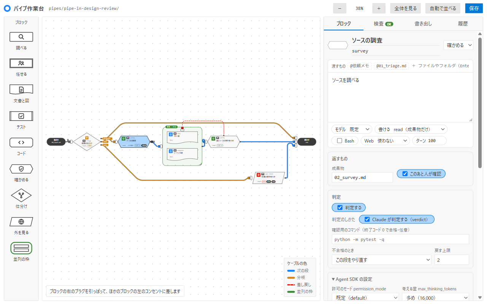

# pipe-in-vscode

[pipe-in](../README.md) の実行を、VSCode の中でパイプライン図とターミナル風の出力として見る拡張。パイプを組み立てる作業台もある。
pipe-in が work_dir に書く記録（`state.json`・`logs/*.jsonl`・成果物の Markdown）は読むだけで、何も書かない。
書くのは、作業台で「保存」を押したときの、開いたパイプのフォルダ（新しいパイプは `.pipe-in/pipes/pipe-in-<名前>/`）の中（`pipe.toml`・`prompts/*.md`・`layout.json`・無いときの `README.md`）だけ。
作業台の「保存した版」は、プロジェクトではなく VSCode が拡張に用意する保存場所に書く。

前の名前の拡張から移るときの手順（設定・コマンド・古い拡張の外し方）は、リポジトリの [移行の文書](../docs/guide/migrate.md) にある。

<picture>
  <source media="(prefers-color-scheme: dark)" srcset="../docs/assets/run-panel-dark.png">
  
</picture>

<sub>「pipe-in: 実行を見る」のパネル。見本の記録（数字は見本）を写したもの。</sub>

## 使い方

```bash
cd vscode
npm ci               # 型検査とビルドの道具（テストだけなら不要）
npm test             # node:test（Node 22 以上）
npm run typecheck
npm run build        # out/extension.cjs
```

VSCode でこのフォルダを開き、F5（拡張機能の開発ホスト）で起動する。コマンドパレットの「pipe-in: 実行を見る」でパネルが開く。

### 普段の VSCode に入れる

```bash
npm install
npm run package                                        # pipe-in-vscode.vsix（ビルドもここで走る）
code --install-extension pipe-in-vscode.vsix --force   # Insiders なら code-insiders
```

入れたら「開発者: ウィンドウの再読み込み」をする。ウィンドウ下のステータスバーに `pipe-in` のボタンが出て、押すとパネルが開く
（コマンドパレットの「pipe-in: 実行を見る」でも同じ）。ボタンの文字は記録に合わせて変わる（動いている段・待ち・合格／不合格など）。
直したら同じ手順で入れ直す（version を上げなくても `--force` で上書きされる）。外すときは `code --uninstall-extension nok.pipe-in-vscode`。

| 設定 | 既定 | 意味 |
| :--- | :--- | :--- |
| `pipe-in.workDir` | `docs/pipeline` | work_dir。ワークスペースの最初のフォルダからの相対パス |

前の版の設定（節の名前が前の名前のもの）は、新しい設定を書いていない間は読む。前の版のコマンド ID も、キー割り当てが効くように登録だけしてある（パレットには出さない）。

### 差し戻しと修正の理由を見る

図の「実装」「判定」「確認」の節は、差し戻し（検証の不合格）や修正の依頼の履歴があるとき、押すか Tab で移って Enter・Space を押すと、右の欄に「理由」（不合格の直す点、修正の依頼の文）が出る。選んだ節につながる矢印が濃くなる。もう一度押すと閉じる。選びはパネルの中だけで持つ。パイプでは、確認の節に修正の依頼の理由だけが出る（パイプの差し戻しはまだ出さない）。

### 時間と動き

- 動いている段の節に経過（`経過 1:23`）、パネルの上に全体の経過が出て、1 秒ごとに増える。確認待ちのときは確認の節が黄色で点滅し、左に待ち時間が出る。終わった段は合計の時間（`m:ss`）。やり直した段は、右の欄の「時間」に回ごとの時間と合計が並ぶ。
- 動いている段の枠が光り、入る矢印の上を点が流れる。差し戻し・修正の依頼が新しく起きると、戻る矢印が一度だけ光る。動きはすべて CSS のアニメーションで、`prefers-reduced-motion: reduce` のときは止まる（数え上げは続く）。
- 数え上げは、拡張が描くときに HTML に入れた「基準の秒」に、パネルが受け取ってからの経過を足すだけ。記録の時刻と今の時刻はパネルの中で比べないので、リモート（WSL・SSH など）で時計がずれていても合う。見えていないあいだは止める。拡張とのメッセージは増えない。
- 始まりの時刻（段のログの `at`・`pending_review.since`）が無い古い記録では、数え上げは出さない。

### パイプの実行を見る

`pipe-in --pipe <名前>` で流したパイプの記録（`<work_dir>/<パイプ名>/`）も見られる。

- work_dir の直下（開発フロー）と、`state.json` を持つ直下のフォルダ（パイプ）を探し、いちばん新しく更新された実行を見る。ステータスバーもその実行を出す。
- 実行が2つ以上あると、パネルの上に実行を選ぶボタンが出る。押すとパネルを閉じるまでその実行を見る。
- パイプの図は `state.json` の段の並び（`stages`）から作る：依頼メモ → 段 →（確認）→ … → 完了。差し戻しがないので判定の節はない。
- 成果物は「依頼メモ・各段の成果物・まとめ」。開けるのはこの一覧にあるものだけ。
- 確認で止まっている（`--pause`）ときは、パネルの帯とステータスバーに「〈段〉の確認を待っている」と確認する文書を出す。
- `state.json` の注意（`warnings`）は、パネルの「注意」の節に出す。

段の成果物と確認の有無（`stages` の `output`・`review`）を記録に残すようになる前のパイプの記録では、確認の節は確認の記録がある段のあとにだけ出し、成果物は依頼メモとまとめだけを出す。

### 使用量

pipe-in（前の名前の 0.2 以降）の記録（`state.json` に `usage_summary` があるもの）では、パネルの右下に「使用量」の節が出る。

- 段の実行ごとと合計の、入力・キャッシュ書き込み・キャッシュ読み込み・出力・うち thinking のトークン数と、キャッシュ再利用率
- モデル別の出力トークンと費用
- 5時間枠・7日枠の使用率の推移（開始 → 終了。途中で枠が戻ったときは最大値も）

ステータスバーの説明にも、利用枠の今の使用率が出る。古い記録では節を出さない（今までどおり）。

### パイプ作業台

<picture>
  <source media="(prefers-color-scheme: dark)" srcset="../docs/assets/pipe-editor-dark.png">
  
</picture>

<sub>パイプ作業台。見本のパイプを開き、段「ソースの調査」を選んだところ。</sub>

コマンドパレットの「pipe-in: パイプ作業台を開く」で、ワークスペースの `.pipe-in/pipes/` と前の版の置き場所（どちらも無くて `pipes/` があればそこ）のパイプを選ぶか、新しく作る。

- 新しいパイプは最初の置き場所の `pipe-in-<名前>/` に書く。前の版のフォルダ名のパイプは、直して保存してもそのフォルダに書く。
- 同じ名前のパイプが2つの置き場所にあれば、新しい置き場所・新しいフォルダ名のほうを開く。新しく作るときに、ほかの置き場所に同じ名前があれば断る（`pipe-in-gen new` と同じ決まり）。

- 左の棚から、形で見分けるブロックを置く（ドラッグなら離した所に、押すか Enter なら真ん中の近くの空いた所に）。長方形は調べる、二重枠は任せる（サブエージェント）、下が波の紙は文書と図、両端に線はテスト、角を落とした形はコード、六角形は確かめる、ひし形は仕分け、平行四辺形は外を見る、緑の大きな枠は並列。
- ブロックの右のプラグを引っぱり、ほかのブロックの左のコンセントに差してつなぐ。右のブロックなら次の段、仕分けからなら分岐、左（前）のブロックなら差し戻し、自分ならやり直し。ケーブルは段をよけて通り、重ならない。
- 差さっているプラグ（ケーブルの先）は掴んで抜き差しできる。ほかのブロックか、そのコンセントの上で離すと差し直し（次の段・分岐・差し戻しの種類はそのまま。合わない先は理由を出して元に戻す）、何もない所で離すと抜ける。差し戻しを抜いても判定は残り、その段をやり直すになる。
- プラグは、ブロックの上でも、ブロックの左のコンセント（縦に並んだタップのどこでも）の上でも差さる。引いている間は、差さる先のブロックが目立つ。
- ケーブルは、ブロックをよける通り道を、角を大きく回る流線型の曲線で描く。引いている最中のケーブルはひものように手元に遅れてついてきて、止めるとまっすぐに戻る（OS の「視差効果を減らす／動きを減らす」設定のときは揺らさず、手元までまっすぐに描く）。
- 判定は、右の「判定」の箱のスイッチで入り切りする。オンにすると、判定のしかた（Claude が判定する・確認用のコマンド）・不合格のとき（この段をやり直す・前の段）・戻す上限を選べる。自分をやり直す判定はケーブルを描かず、カードの札「判定 ↻」で示す（前の段へ戻すときは赤い点線のケーブルと「判定 ↩」）。
- ブロックを押すと、右で「Claude への1回分の依頼」を組み立てる：渡すもの・頼むこと・モデル・書ける範囲・Bash・Web・ターン、返すもの（成果物・人の確認・分岐の選択肢）、判定、Agent SDK の設定（許可のモード・考える量・予備のモデル・この段の決まり・追加で読めるフォルダ・サブエージェント・MCP サーバー）。「Claude に届く指示を見る」で、pipe-in が送る文面を確かめられる。
- 「検査」は `pipe-in-gen check` と同じ決まり。「書き出し」で、保存するファイルの中身を下見できる。保存は「保存」か Ctrl+S。
- ブロックの位置と形は `layout.json` に残る（pipe-in は読まない）。無いパイプは、開いたときに自動で並べる。
- 作業台で読めない書き方（インラインの表など）や、開発フローのパイプ（`kind = "dev"`）は、理由を出して開かない。
- 段を動かして中心が並列の枠に入ると、その段は並列になる（入った・出たときは下に知らせが出る）。
- 右クリックでメニューが出る（Shift+F10 かメニューキーでも。矢印で選び Enter、Esc で閉じる）。
  - ブロック：名前を変える・指示文を開く（保存済みの `prompts/` を読むだけで開く）・渡される指示を見る・複製する・人の確認をつける/外す・枠に入れる/出す・ケーブルをすべて抜く・消す
  - 並列の枠：名前を変える・枠だけ消す・中の段ごと消す
  - 何もないところ：ここに段を足す・ここに並列の枠を作る・貼り付け・自動で並べる・全体を見る
  - 使えない項目は薄く出し、理由を添える。ケーブルにはメニューを出さない（抜き差しはドラッグで）。
- つながっていないブロック（棚から引いたものも）を「次の段」のケーブルの上に落とすと、その間に挟まる（落とせる間はケーブルが太くなる）。場所が足りなければ右側をずらす。
- Shift+クリックで足して選ぶ、何もないところからの Shift+ドラッグで囲んで選ぶ。選んだものはまとめて動かし、Delete でまとめて消せる。図を動かすのは、何もないところのドラッグか中ボタンのドラッグ。
- Ctrl+Z で元に戻す、Ctrl+Y（Ctrl+Shift+Z）でやり直す。Ctrl+C / Ctrl+V で写して貼り、Ctrl+D で複製する。入力欄の中では、これらは欄の文字に効く。
- 「履歴」のタブに、操作の一覧（押すとその時点へ戻る）と、保存した版の一覧（押すと読み込む。保存を押すまでファイルは書かない）が出る。保存した版は VSCode が拡張に用意する保存場所に、パイプごとに新しい方から50版まで残す（プロジェクトには書かない。前の名前の拡張で残した版は引き継がない）。
- 保存していない変更があると、タブ名に ● がつく。保存せずに閉じたときは、その形を下書きとして保存した版に残し、通知の「開き直す」で続きから開ける（VSCode はパネルを閉じるのを止められないため）。

| 設定 | 既定 | 意味 |
| :--- | :--- | :--- |
| `pipe-in.pipesDir` | （空） | 作業台で読み書きするパイプの置き場所。ワークスペースの最初のフォルダからの相対パスか、絶対パス。空なら `.pipe-in/pipes` と前の版の置き場所（どちらも無くて `pipes` があれば `pipes`） |

## 層の決まり

層（domain・app・view・infra・webview・入口）ごとに置くものと、使ってよい部品は、リポジトリの `docs/development/design.md` の「拡張の層」にまとめてある（`src/architecture.test.ts` が検査する）。
`vscode` を import してよいのは `src/extension.ts` だけ。ログから来た文字は必ず `escapeHtml` を通し、パネルの中ではインラインの `style="…"` 属性を使わない（`src/webview/csp.test.ts` が検査する）。
